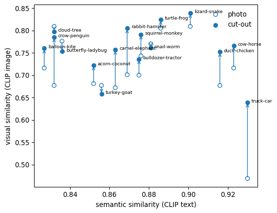
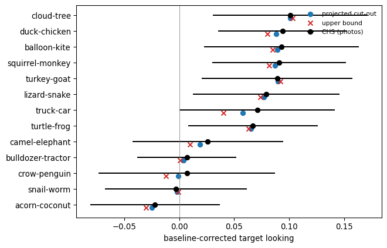

Photo vs cut-out: item scores and CHS projection
================

The analyses behind `docs/report.md`, from the CSVs written by
`pipeline/00`–`08`. Nothing is recomputed here; rerun the pipeline
scripts to update them.

## CHS performance on the hard pairs

Baseline-corrected target looking per named word (CHS hard trials,
main-analysis exclusions), `00_chs_hard_pairs.py`.

``` python
print(perf[['pair', 'named', 'n', 'corrected', 'se', 'p', 'section']].sort_values(['pair', 'named']).round(3).to_string(index=False))
```

                 pair     named    n  corrected    se     p section
        acorn-coconut     acorn 72.0     -0.026 0.042 0.526 sample1
        acorn-coconut   coconut 69.0     -0.018 0.041 0.664 sample1
         balloon-kite   balloon 56.0      0.109 0.047 0.023 sample2
         balloon-kite      kite 58.0      0.077 0.047 0.110 sample2
       bathtub-shower   bathtub 48.0      0.021 0.057 0.718 sample2
       bathtub-shower    shower 55.0     -0.014 0.049 0.780 sample2
    bulldozer-tractor bulldozer 83.0     -0.008 0.036 0.816 sample1
    bulldozer-tractor   tractor 86.0      0.023 0.034 0.503 sample1
       camel-elephant     camel 52.0      0.043 0.052 0.420 sample2
       camel-elephant  elephant 55.0      0.009 0.044 0.837 sample2
        cheese-butter    butter 75.0     -0.001 0.039 0.978 sample1
        cheese-butter    cheese 76.0      0.010 0.042 0.814 sample1
           cloud-tree     cloud 48.0      0.100 0.042 0.022 sample2
           cloud-tree      tree 52.0      0.101 0.052 0.057 sample2
         crow-penguin      crow 46.0      0.039 0.041 0.349 sample2
         crow-penguin   penguin 49.0     -0.024 0.060 0.691 sample2
         duck-chicken   chicken 49.0      0.099 0.044 0.027 sample2
         duck-chicken      duck 56.0      0.088 0.038 0.024 sample2
         lizard-snake    lizard 56.0      0.089 0.038 0.023 sample2
         lizard-snake     snake 50.0      0.069 0.054 0.209 sample2
           potato-pot       pot 76.0     -0.031 0.038 0.424 sample1
           potato-pot    potato 75.0      0.127 0.036 0.001 sample1
           snail-worm     snail 79.0      0.032 0.040 0.439 sample1
           snail-worm      worm 71.0     -0.037 0.046 0.421 sample1
      squirrel-monkey    monkey 74.0      0.065 0.041 0.119 sample1
      squirrel-monkey  squirrel 81.0      0.117 0.041 0.006 sample1
            truck-car       car 58.0      0.086 0.044 0.058 sample2
            truck-car     truck 56.0      0.057 0.048 0.244 sample2
          turkey-goat      goat 71.0      0.059 0.046 0.203 sample1
          turkey-goat    turkey 74.0      0.118 0.045 0.010 sample1
          turtle-frog      frog 74.0      0.025 0.039 0.521 sample1
          turtle-frog    turtle 79.0      0.108 0.040 0.009 sample1

## Visual and semantic similarity, photo → cut-out

CLIP ViT-B/32 cosine on the final 600 px stimuli (`05_similarity.py`):
image–image for visual, “a \<word\>” text–text for semantic.

``` python
s = sim.assign(change=sim.cutout - sim.photo).sort_values('change', ascending=False)
print(s.round(3).to_string(index=False))
print(f"\nmean visual similarity {sim.photo.mean():.3f} -> {sim.cutout.mean():.3f}; {(sim.cutout > sim.photo).sum()}/16 pairs increase")
print(f"visual vs semantic: photo r = {stats.pearsonr(sim.photo, sim.text)[0]:.2f}, cut-out r = {stats.pearsonr(sim.cutout, sim.text)[0]:.2f}")
```

                 pair   domain  text  photo  cutout  change
            truck-car artifact 0.930  0.469   0.639   0.170
         crow-penguin   animal 0.832  0.677   0.785   0.108
       rabbit-hamster   animal 0.869  0.701   0.805   0.104
       camel-elephant   animal 0.863  0.672   0.757   0.085
         duck-chicken   animal 0.916  0.677   0.752   0.075
            cow-horse   animal 0.923  0.716   0.766   0.050
      squirrel-monkey   animal 0.876  0.743   0.791   0.048
         balloon-kite artifact 0.827  0.716   0.760   0.044
        acorn-coconut    plant 0.852  0.681   0.722   0.041
    bulldozer-tractor artifact 0.875  0.700   0.736   0.036
         lizard-snake   animal 0.901  0.809   0.839   0.030
          turtle-frog   animal 0.886  0.805   0.824   0.019
           snail-worm   animal 0.881  0.770   0.761  -0.009
           cloud-tree   nature 0.832  0.809   0.797  -0.012
          turkey-goat   animal 0.856  0.677   0.658  -0.019
    butterfly-ladybug   animal 0.836  0.776   0.753  -0.023

    mean visual similarity 0.712 -> 0.759; 12/16 pairs increase
    visual vs semantic: photo r = -0.35, cut-out r = -0.14

``` python
fig, ax = plt.subplots(figsize=(6, 5))
for r in sim.itertuples():
    ax.annotate('', (r.text, r.cutout), (r.text, r.photo), arrowprops=dict(arrowstyle='->', color='tab:blue', lw=1))
    ax.text(r.text + .002, r.cutout, r.pair, fontsize=7)
ax.scatter(sim.text.values, sim.photo.values, facecolors='none', edgecolors='tab:blue', label='photo')
ax.scatter(sim.text.values, sim.cutout.values, color='tab:blue', label='cut-out')
ax.set_xlabel('semantic similarity (CLIP text)'); ax.set_ylabel('visual similarity (CLIP image)'); ax.legend(frameon=False)
```

    <matplotlib.legend.Legend at 0x7fca90338f10>



## Saliency imbalance

GBVS left − right imbalance of each side-by-side pair display
(`06_saliency.py`). Cut-outs remove the background’s contribution.

``` python
w = sal.pivot(index='pair', columns='fmt', values='imbalance')[['photo', 'cutout']]
print(w.assign(abs_change=w.cutout.abs() - w.photo.abs()).round(3).sort_values('abs_change').to_string())
print(f"\nmean |imbalance| photo {w.photo.abs().mean():.3f}, cut-out {w.cutout.abs().mean():.3f}")
```

    fmt                photo  cutout  abs_change
    pair                                        
    cloud-tree        -0.239   0.038      -0.201
    cow-horse         -0.304  -0.150      -0.154
    balloon-kite      -0.356  -0.245      -0.112
    bulldozer-tractor  0.250   0.145      -0.105
    squirrel-monkey   -0.195  -0.100      -0.095
    turkey-goat        0.054   0.033      -0.021
    snail-worm        -0.071  -0.069      -0.002
    duck-chicken      -0.002  -0.007       0.004
    truck-car          0.002   0.016       0.014
    acorn-coconut     -0.088  -0.107       0.019
    butterfly-ladybug  0.260   0.301       0.041
    rabbit-hamster     0.117   0.175       0.058
    camel-elephant     0.162   0.256       0.094
    turtle-frog       -0.116  -0.227       0.111
    crow-penguin      -0.134  -0.278       0.144
    lizard-snake      -0.223  -0.403       0.179

    mean |imbalance| photo 0.161, cut-out 0.159

## Item-level moderators

From `07_item_moderators.py`. **Background diagnosticity** = CLIP 2AFC
on the background alone (object boxed out in grey): p(own word vs
partner). **Context discriminability** = diagnosticity A + diagnosticity
B − 1, per pair. **Background saliency share** = share of GBVS mass
outside the object.

``` python
a = mod.merge(P[['pair', 'word_a']], left_on='word', right_on='word_a')
b = mod.merge(P[['pair', 'word_b']], left_on='word', right_on='word_b')
t = a[['pair', 'bg_diag', 'bg_sal', 'context_discrim_pair']].merge(b[['pair', 'bg_diag', 'bg_sal']], on='pair', suffixes=('_A', '_B'))
print(t.sort_values('context_discrim_pair', ascending=False).round(2).to_string(index=False))
print(f"\ndiagnosticity vs saliency share across images: r = {stats.pearsonr(mod.bg_diag, mod.bg_sal)[0]:.2f}")
print(f"CLIP recognition: photo min {mod.rec_photo.min():.3f}, cut-out min {mod.rec_cut.min():.3f} (at ceiling)")
```

                 pair  bg_diag_A  bg_sal_A  context_discrim_pair  bg_diag_B  bg_sal_B
         duck-chicken       0.78      0.52                  0.64       0.86      0.54
         crow-penguin       0.66      0.85                  0.60       0.95      0.73
         balloon-kite       0.58      0.56                  0.53       0.95      0.56
       camel-elephant       0.76      0.56                  0.51       0.75      0.67
       rabbit-hamster       0.84      0.51                  0.48       0.65      0.56
      squirrel-monkey       0.64      0.48                  0.47       0.82      0.56
        acorn-coconut       0.83      0.53                  0.24       0.41      0.27
          turkey-goat       0.78      0.46                  0.20       0.42      0.57
    bulldozer-tractor       0.45      0.43                  0.18       0.73      0.31
    butterfly-ladybug       0.54      0.45                  0.17       0.64      0.56
          turtle-frog       0.51      0.47                  0.14       0.62      0.36
            cow-horse       0.90      0.69                  0.13       0.22      0.63
           cloud-tree       0.99      0.56                  0.10       0.11      0.53
            truck-car       0.36      0.44                 -0.01       0.63      0.43
         lizard-snake       0.56      0.76                 -0.10       0.34      0.43
           snail-worm       0.38      0.63                 -0.10       0.51      0.74

    diagnosticity vs saliency share across images: r = 0.18
    CLIP recognition: photo min 0.908, cut-out min 0.927 (at ceiling)

## What CHS projects for cut-outs

`08_chs_projection.py`: fit corrected looking on CLIP photo similarity
across all 64 CHS namings, then shift each pair by slope × (cut-out −
photo similarity) on the new stimuli. `proj_up` uses the slope implied
by attributing the whole easy–hard gap to similarity.

``` python
q = proj.dropna(subset=['proj']).assign(shift=lambda d: d.proj - d.obs).sort_values('obs', ascending=False)
print(q[['pair', 'obs', 'sim_chs', 'sim_cut', 'dsim', 'proj', 'proj_up', 'shift']].round(3).to_string(index=False))
```

                 pair    obs  sim_chs  sim_cut   dsim   proj  proj_up  shift
           cloud-tree  0.101    0.870    0.797 -0.012  0.101    0.103  0.000
         duck-chicken  0.094    0.745    0.752  0.075  0.088    0.080 -0.006
         balloon-kite  0.093    0.788    0.760  0.044  0.089    0.085 -0.004
      squirrel-monkey  0.091    0.703    0.791  0.048  0.087    0.082 -0.004
          turkey-goat  0.089    0.731    0.658 -0.019  0.090    0.092  0.001
         lizard-snake  0.079    0.813    0.839  0.030  0.077    0.074 -0.002
            truck-car  0.071    0.468    0.639  0.170  0.058    0.040 -0.013
          turtle-frog  0.067    0.744    0.824  0.019  0.065    0.063 -0.002
       camel-elephant  0.026    0.732    0.757  0.085  0.019    0.010 -0.007
    bulldozer-tractor  0.007    0.732    0.736  0.036  0.004    0.001 -0.003
         crow-penguin  0.007    0.693    0.785  0.108 -0.001   -0.012 -0.008
           snail-worm -0.003    0.695    0.761 -0.009 -0.002   -0.001  0.001
        acorn-coconut -0.022    0.736    0.722  0.041 -0.025   -0.030 -0.003

``` python
fig, ax = plt.subplots(figsize=(7, 5)); y = np.arange(len(q))
ax.errorbar(q.obs.values, y, xerr=1.96 * q.se.values, fmt='o', color='k', label='CHS (photos)')
ax.scatter(q.proj.values, y + .2, color='tab:blue', label='projected cut-out'); ax.scatter(q.proj_up.values, y + .2, color='tab:red', marker='x', label='upper bound')
ax.set_yticks(y); ax.set_yticklabels(q.pair); ax.axvline(0, color='grey', lw=.6); ax.invert_yaxis()
ax.set_xlabel('baseline-corrected target looking'); ax.legend(frameon=False, fontsize=8)
```

    <matplotlib.legend.Legend at 0x7fca9029a220>



Every pair but truck–car moves by less than .01: similarity alone
predicts almost no format effect, which is why the study has to be run.
