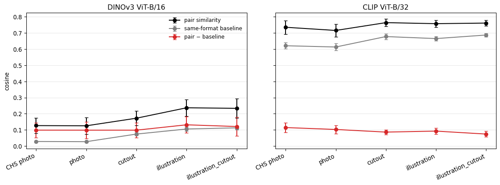
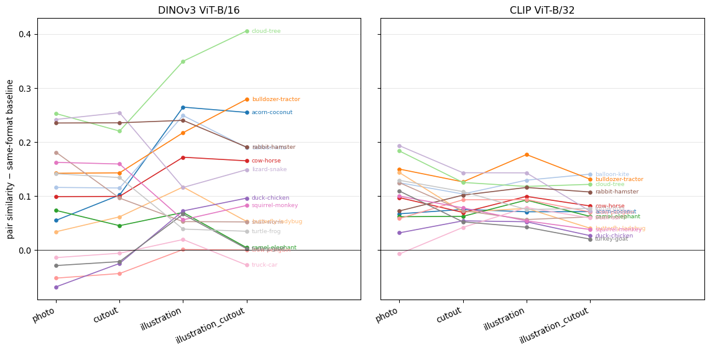

Pair similarity across visual formats
================

How alike do the two images of each hard pair look to a vision model, as
the stimuli move from photo toward abstraction (photo → cut-out →
illustration → line drawing → doodle)? Embeddings come from
`pipeline/12_embeddings.py`: DINOv3 ViT-B/16 (LVD-1689M, pooled CLS) and
CLIP ViT-B/32 (the model used in CHS). Similarity is cosine between the
pair’s two images. Formats that have not been generated yet are simply
absent.

## Raw similarity rises with abstraction, but so does everything else

``` python
for m, name in MODELS.items():
    d = T[m][T[m].version.isin(fmts)]
    print(name); print(d.groupby('version')[['sim', 'baseline', 'excess', 'rank']].mean().reindex(fmts).round(3).to_string(), '\n')
```

    DINOv3 ViT-B/16
                           sim  baseline  excess   rank
    version                                            
    CHS photo            0.127     0.028   0.098  0.834
    photo                0.125     0.027   0.098  0.778
    cutout               0.172     0.074   0.098  0.811
    illustration         0.237     0.105   0.131  0.883
    illustration_cutout  0.234     0.113   0.121  0.814 

    CLIP ViT-B/32
                           sim  baseline  excess   rank
    version                                            
    CHS photo            0.735     0.621   0.114  0.899
    photo                0.716     0.613   0.103  0.889
    cutout               0.764     0.678   0.086  0.935
    illustration         0.758     0.665   0.092  0.936
    illustration_cutout  0.761     0.687   0.074  0.898 

Raw pair similarity goes up as detail is removed. The same-format
baseline goes up as much or more: once photo texture, lighting and scene
are gone, *any* two images in a style resemble each other. Raw cosine is
therefore not comparable across formats. On an LWL trial the target and
distractor are always shown in the same format, so the model quantity
that matters is the pair’s similarity *relative to its format*: the
excess, or the partner’s rank.

``` python
fig, axes = plt.subplots(1, 2, figsize=(12, 4.5), sharey=True)
for ax, (m, name) in zip(axes, MODELS.items()):
    g = T[m].groupby('version')[['sim', 'baseline', 'excess']].agg(['mean', 'sem']).reindex(fmts)
    for col, c in [('sim', 'k'), ('baseline', 'tab:grey'), ('excess', 'tab:red')]:
        ax.errorbar(range(len(fmts)), g[(col, 'mean')].values, yerr=1.96 * g[(col, 'sem')].values, marker='o', color=c, capsize=3,
                    label={'sim': 'pair similarity', 'baseline': 'same-format baseline', 'excess': 'pair − baseline'}[col])
    ax.set_xticks(range(len(fmts))); ax.set_xticklabels(fmts, rotation=25, ha='right'); ax.set_title(name); ax.grid(axis='y', alpha=.3)
axes[0].set_ylabel('cosine'); axes[0].legend(frameon=False, fontsize=9); fig.tight_layout()
```



## Per pair: which pairs does abstraction separate, and which does it merge?

Excess similarity per pair. If abstraction removed exactly the details
that make a pair confusable, the pair’s excess should fall; if it
removed the details that tell the two apart, it should rise.

``` python
for m, name in MODELS.items():
    w = T[m].pivot(index='pair', columns='version', values='excess')[[f for f in FINAL if f in fmts]]
    print(name); print(w.sort_values('photo').round(3).to_string(), '\n')
```

    DINOv3 ViT-B/16
    version            photo  cutout  illustration  illustration_cutout
    pair                                                               
    duck-chicken      -0.068  -0.024         0.073                0.096
    crow-penguin      -0.052  -0.043         0.001                0.000
    turkey-goat       -0.028  -0.021         0.066                0.003
    truck-car         -0.014  -0.006         0.020               -0.027
    butterfly-ladybug  0.034   0.062         0.117                0.053
    acorn-coconut      0.055   0.102         0.264                0.255
    camel-elephant     0.074   0.045         0.070                0.005
    cow-horse          0.099   0.100         0.172                0.165
    balloon-kite       0.116   0.115         0.249                0.190
    turtle-frog        0.141   0.134         0.039                0.035
    bulldozer-tractor  0.142   0.143         0.217                0.279
    squirrel-monkey    0.162   0.159         0.056                0.083
    snail-worm         0.181   0.096         0.053                0.052
    rabbit-hamster     0.235   0.236         0.240                0.191
    lizard-snake       0.242   0.254         0.116                0.149
    cloud-tree         0.253   0.220         0.349                0.405 

    CLIP ViT-B/32
    version            photo  cutout  illustration  illustration_cutout
    pair                                                               
    truck-car         -0.007   0.042         0.079                0.060
    duck-chicken       0.032   0.054         0.053                0.027
    crow-penguin       0.059   0.093         0.094                0.071
    camel-elephant     0.062   0.063         0.093                0.062
    acorn-coconut      0.067   0.075         0.071                0.071
    rabbit-hamster     0.073   0.102         0.116                0.108
    cow-horse          0.097   0.070         0.099                0.082
    squirrel-monkey    0.100   0.078         0.054                0.038
    turkey-goat        0.109   0.052         0.043                0.021
    balloon-kite       0.125   0.104         0.129                0.141
    snail-worm         0.125   0.073         0.057                0.062
    turtle-frog        0.129   0.108         0.075                0.077
    butterfly-ladybug  0.143   0.070         0.077                0.041
    bulldozer-tractor  0.150   0.126         0.177                0.131
    cloud-tree         0.183   0.125         0.118                0.122
    lizard-snake       0.193   0.143         0.143                0.072 

``` python
fin = [f for f in FINAL if f in fmts]
fig, axes = plt.subplots(1, 2, figsize=(12, 6), sharey=True)
for ax, (m, name) in zip(axes, MODELS.items()):
    w = T[m].pivot(index='pair', columns='version', values='excess')[fin]
    for i, (p, row) in enumerate(w.iterrows()):
        c = plt.cm.tab20(i % 20); ax.plot(range(len(fin)), row.values, marker='o', ms=4, color=c, lw=1.2)
        ax.text(len(fin) - 1 + .08, row.values[-1], p, fontsize=7, color=c, va='center')
    ax.axhline(0, color='k', lw=.6); ax.set_xticks(range(len(fin))); ax.set_xticklabels(fin, rotation=25, ha='right')
    ax.set_xlim(-.3, len(fin) + .8); ax.set_title(name); ax.grid(axis='y', alpha=.3)
axes[0].set_ylabel('pair similarity − same-format baseline'); fig.tight_layout()
```



How much of the item ordering survives each format change? Spearman
correlation of per-pair excess across the 16 pairs:

``` python
for m, name in MODELS.items():
    w = T[m].pivot(index='pair', columns='version', values='excess')[fin]
    print(name); print(w.corr(method='spearman').round(2).to_string(), '\n')
```

    DINOv3 ViT-B/16
    version              photo  cutout  illustration  illustration_cutout
    version                                                              
    photo                 1.00    0.91          0.38                 0.56
    cutout                0.91    1.00          0.52                 0.69
    illustration          0.38    0.52          1.00                 0.91
    illustration_cutout   0.56    0.69          0.91                 1.00 

    CLIP ViT-B/32
    version              photo  cutout  illustration  illustration_cutout
    version                                                              
    photo                 1.00    0.69          0.40                 0.40
    cutout                0.69    1.00          0.67                 0.73
    illustration          0.40    0.67          1.00                 0.85
    illustration_cutout   0.40    0.73          0.85                 1.00 

## A recognition-side model measure: CLIP word → image 2AFC

Embedding similarity is not recognition. Closer to the task: give CLIP
the spoken word (“a photo of a {word}” / “a drawing of a {word}”) and
ask whether it prefers the target over its partner, in each format. In
CHS photos CLIP was at ceiling, so this mainly shows whether any format
pulls it off ceiling.

``` python
import torch, open_clip
clip, _, _ = open_clip.create_model_and_transforms('ViT-B-32', pretrained='openai'); clip.eval(); tok = open_clip.get_tokenizer('ViT-B-32')
TEMPL = ['a photo of a {}.', 'a drawing of a {}.', 'an illustration of a {}.', 'a picture of a {}.']
label = lambda w: 'chicken' if w.startswith('chicken') else w
with torch.no_grad():
    TX = {}
    for w in W:
        t = clip.encode_text(tok([s.format(label(w)) for s in TEMPL])); t = t / t.norm(dim=-1, keepdim=True)
        t = t.mean(0); TX[w] = (t / t.norm()).numpy()
partner = {**dict(zip(P.word_a, P.word_b)), **dict(zip(P.word_b, P.word_a))}
rows = []
for v in fmts:
    for w in W:
        if (v, w) not in E['clip'] or (v, partner[w]) not in E['clip']: continue
        lo = 100 * np.array([E['clip'][(v, w)] @ TX[w], E['clip'][(v, w)] @ TX[partner[w]]])
        rows.append(dict(version=v, word=w, p_correct=np.exp(lo[0]) / np.exp(lo).sum()))
rec = pd.DataFrame(rows)
print(rec.groupby('version').p_correct.agg(['mean', 'min', lambda s: (s < .5).sum()]).rename(columns={'<lambda_0>': 'n wrong'}).reindex(fmts).round(3).to_string())
```

                          mean    min  n wrong
    version                                   
    CHS photo            0.994  0.871        0
    photo                0.991  0.821        0
    cutout               0.993  0.867        0
    illustration         0.994  0.967        0
    illustration_cutout  0.994  0.968        0

``` python
print(rec.pivot(index='word', columns='version', values='p_correct')[fmts].round(2).sort_values('photo').head(12).to_string())
```

    version    CHS photo  photo  cutout  illustration  illustration_cutout
    word                                                                  
    lizard          0.87   0.82    0.99          0.97                 0.98
    frog            0.99   0.93    0.87          0.99                 0.99
    acorn           1.00   0.99    0.97          0.97                 0.97
    butterfly       0.99   0.99    1.00          1.00                 1.00
    snake           0.99   0.99    0.99          0.98                 0.98
    turkey          1.00   1.00    1.00          1.00                 1.00
    truck           0.99   1.00    0.99          1.00                 1.00
    tree            1.00   1.00    1.00          1.00                 1.00
    tractor         0.99   1.00    1.00          1.00                 1.00
    squirrel        1.00   1.00    1.00          1.00                 1.00
    snail           1.00   1.00    1.00          1.00                 1.00
    rabbit          1.00   1.00    0.99          1.00                 0.99

## Illustration rounds

Words whose illustration was regenerated (round 0 = first pass; final =
current `stimuli/images/illustration`). Only pairs containing a
regenerated word can change.

``` python
for m, name in MODELS.items():
    d = T[m]; rr = sorted(v for v in d.version.unique() if 'round' in v)
    if not rr: continue
    cols = [v for v in rr if v.startswith('illustration round')] + ['illustration'] + \
           [v for v in rr if v.startswith('illustration_cutout round')] + ['illustration_cutout']
    w = d.pivot(index='pair', columns='version', values='excess')[cols]
    print(name); print(w[(w.max(axis=1) - w.min(axis=1)) > 1e-4].round(3).to_string(), '\n')
```

    DINOv3 ViT-B/16
    version            illustration round 0  illustration  illustration_cutout round 0  illustration_cutout
    pair                                                                                                   
    acorn-coconut                     0.264         0.264                        0.254                0.255
    balloon-kite                      0.444         0.249                        0.302                0.190
    bulldozer-tractor                 0.217         0.217                        0.279                0.279
    butterfly-ladybug                 0.116         0.117                        0.052                0.053
    camel-elephant                    0.066         0.070                        0.004                0.005
    cloud-tree                        0.344         0.349                        0.407                0.405
    cow-horse                         0.169         0.172                        0.165                0.165
    crow-penguin                      0.001         0.001                        0.001                0.000
    duck-chicken                      0.073         0.073                        0.097                0.096
    lizard-snake                      0.088         0.116                        0.152                0.149
    rabbit-hamster                    0.237         0.240                        0.190                0.191
    snail-worm                        0.051         0.053                        0.053                0.052
    squirrel-monkey                   0.054         0.056                        0.082                0.083
    truck-car                         0.017         0.020                       -0.028               -0.027
    turkey-goat                       0.062         0.066                        0.001                0.003
    turtle-frog                       0.056         0.039                        0.052                0.035 

    CLIP ViT-B/32
    version            illustration round 0  illustration  illustration_cutout round 0  illustration_cutout
    pair                                                                                                   
    acorn-coconut                     0.066         0.071                        0.068                0.071
    balloon-kite                      0.128         0.129                        0.160                0.141
    bulldozer-tractor                 0.172         0.177                        0.129                0.131
    butterfly-ladybug                 0.073         0.077                        0.038                0.041
    camel-elephant                    0.088         0.093                        0.061                0.062
    cloud-tree                        0.112         0.118                        0.118                0.122
    cow-horse                         0.095         0.099                        0.079                0.082
    crow-penguin                      0.088         0.094                        0.068                0.071
    duck-chicken                      0.050         0.053                        0.025                0.027
    lizard-snake                      0.127         0.143                        0.078                0.072
    rabbit-hamster                    0.112         0.116                        0.105                0.108
    snail-worm                        0.053         0.057                        0.061                0.062
    squirrel-monkey                   0.050         0.054                        0.036                0.038
    truck-car                         0.074         0.079                        0.057                0.060
    turkey-goat                       0.038         0.043                        0.018                0.021
    turtle-frog                       0.077         0.075                        0.039                0.077 

## What this means for the format hypothesis

- **Models do not predict that abstraction makes the pairs harder.**
  Relative to their format, DINOv3 sees the pairs slightly *more* alike
  in illustrations (excess .10 → .13), CLIP slightly *less* alike (.10 →
  .07–.09); both are small next to the rise in raw similarity, and the
  two models disagree on direction. CLIP word → image 2AFC is at ceiling
  in every format (≥ .99 mean), so no format makes the words harder for
  it.
- **If children recognise the words better in illustrations or line
  drawings**, that is a format effect the embedding models do not
  predict: a model–child dissociation. The interpretation would be that
  the details abstraction removes (texture, lighting, background) are
  noise for toddlers, not cues.
- **The item-level test is sharper.** Some pairs’ excess moves in
  opposite directions across formats (e.g. lizard–snake drops,
  acorn–coconut rises). A format × model-excess interaction on
  baseline-corrected looking tests whether the item-specific changes
  predict children’s item-specific changes. A format main effect with a
  null interaction is the dissociation.
- **Caveats.** Cosine on a pooled embedding is one readout of a model,
  not its discriminability. CLIP 2AFC is near ceiling. Illustration
  cut-outs differ from photo cut-outs in colour as well as detail, so
  line drawings and doodles are the cleaner “fewer details” contrast.
  With 16 pairs the item-level interaction has little power; the format
  main effect is the realistic primary test.
