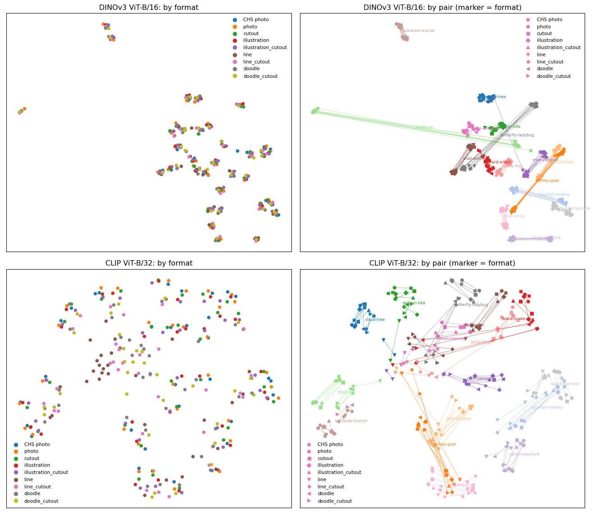
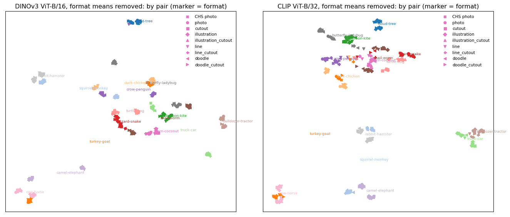

UMAP of the stimuli across formats
================

Two-dimensional UMAP of every stimulus image in every format, from the
embeddings written by `pipeline/12_embeddings.py` (DINOv3 ViT-B/16 and
CLIP ViT-B/32; cosine metric). Illustration history rounds are left out.

## All formats together

Coloured by format (left) and by pair (right, marker = format). Lines
join the two images of a pair within a format.

``` python
fig, axes = plt.subplots(2, 2, figsize=(14, 12))
for row, (m, name) in zip(axes, MODELS.items()):
    k, X = data[m]; U = run(X); k = k.assign(x=U[:, 0], y=U[:, 1])
    fm = [f for f in ORDER if f in set(k.version)]
    for f in fm:
        s = k[k.version == f]; row[0].scatter(s.x.values, s.y.values, s=22, color=FC[f], label=f)
    row[0].set_title(f'{name}: by format'); row[0].legend(fontsize=8, frameon=False, markerscale=1.3)
    for r in P.itertuples():
        for f in fm:
            s = k[(k.version == f) & k.word.isin([r.word_a, r.word_b])]
            if len(s) == 2: row[1].plot(s.x.values, s.y.values, color=PC[r.pair], lw=.7, alpha=.6)
    for f in fm:
        s = k[k.version == f]; row[1].scatter(s.x.values, s.y.values, s=26, c=[PC[pair_of[w]] for w in s.word], marker=MK[f], label=f)
    for r in P.itertuples():
        s = k[k.word.isin([r.word_a, r.word_b])]; row[1].text(s.x.mean(), s.y.mean(), r.pair, fontsize=6.5, color=PC[r.pair])
    row[1].set_title(f'{name}: by pair (marker = format)'); row[1].legend(fontsize=8, frameon=False)
    for ax in row: ax.set_xticks([]); ax.set_yticks([])
fig.tight_layout()
```



Format dominates: each format forms its own cloud, which is the
shared-style baseline from `02_format_similarity`. Item structure is
visible only within a cloud.

## With the shared style removed

Subtract each format’s mean embedding (and re-normalise) before UMAP.
What remains is how each image differs from the rest of its format, so
items can line up across formats if the model sees the same object in
them.

``` python
fig, axes = plt.subplots(1, 2, figsize=(14, 6))
for ax, (m, name) in zip(axes, MODELS.items()):
    k, X = data[m]; Xc = X.copy()
    for f in k.version.unique():
        i = (k.version == f).values; Xc[i] -= Xc[i].mean(0)
    Xc /= np.linalg.norm(Xc, axis=1, keepdims=True); U = run(Xc); k = k.assign(x=U[:, 0], y=U[:, 1])
    fm = [f for f in ORDER if f in set(k.version)]
    for f in fm:
        s = k[k.version == f]; ax.scatter(s.x.values, s.y.values, s=26, c=[PC[pair_of[w]] for w in s.word], marker=MK[f], label=f)
    for r in P.itertuples():
        s = k[k.word.isin([r.word_a, r.word_b])]; ax.text(s.x.mean(), s.y.mean(), r.pair, fontsize=7, color=PC[r.pair])
    ax.set_title(f'{name}, format means removed: by pair (marker = format)'); ax.legend(fontsize=8, frameon=False)
    ax.set_xticks([]); ax.set_yticks([])
fig.tight_layout()
```



How well does each format’s version of a word find the same word in the
other formats? For each image, the share of the other formats in which
its nearest neighbour (cosine, format means removed) is the same word:

``` python
for m, name in MODELS.items():
    k, X = data[m]; Xc = X.copy()
    for f in k.version.unique():
        i = (k.version == f).values; Xc[i] -= Xc[i].mean(0)
    Xc /= np.linalg.norm(Xc, axis=1, keepdims=True)
    fm = [f for f in ORDER if f in set(k.version)]; M = pd.DataFrame(index=fm, columns=fm, dtype=float)
    for f in fm:
        for g in fm:
            if f == g: continue
            a, b = k[k.version == f], k[k.version == g]
            S = Xc[a.index] @ Xc[b.index].T
            M.loc[f, g] = np.mean(b.word.values[S.argmax(1)] == a.word.values)
    print(name, '(row = query format, column = searched format; chance ≈ 1/32)'); print(M.round(2).to_string(), '\n')
```

    DINOv3 ViT-B/16 (row = query format, column = searched format; chance ≈ 1/32)
                         CHS photo  photo  cutout  illustration  illustration_cutout  line  line_cutout  doodle  doodle_cutout
    CHS photo                  NaN   0.94    1.00          1.00                 0.97  0.91         0.97    0.91           0.84
    photo                     0.94    NaN    1.00          1.00                 1.00  1.00         1.00    0.94           0.94
    cutout                    0.97   1.00     NaN          1.00                 1.00  1.00         1.00    0.97           0.94
    illustration              1.00   1.00    1.00           NaN                 1.00  1.00         1.00    0.94           0.91
    illustration_cutout       1.00   1.00    1.00          1.00                  NaN  1.00         1.00    0.97           0.94
    line                      0.88   0.94    0.97          0.97                 0.97   NaN         0.97    0.94           0.91
    line_cutout               0.97   1.00    1.00          1.00                 1.00  1.00          NaN    0.94           0.94
    doodle                    0.88   0.91    0.94          0.97                 0.94  0.88         0.94     NaN           1.00
    doodle_cutout             0.88   0.97    0.94          0.97                 0.94  0.91         0.94    1.00            NaN 

    CLIP ViT-B/32 (row = query format, column = searched format; chance ≈ 1/32)
                         CHS photo  photo  cutout  illustration  illustration_cutout  line  line_cutout  doodle  doodle_cutout
    CHS photo                  NaN   0.97    0.97          0.97                 0.94  0.66         0.78    0.81           0.78
    photo                     1.00    NaN    1.00          1.00                 1.00  0.69         0.78    0.75           0.78
    cutout                    0.97   1.00     NaN          1.00                 1.00  0.72         0.94    0.81           0.88
    illustration              1.00   0.97    0.97           NaN                 1.00  0.69         0.81    0.75           0.78
    illustration_cutout       1.00   1.00    1.00          1.00                  NaN  0.66         0.88    0.81           0.94
    line                      0.72   0.69    0.78          0.81                 0.75   NaN         0.97    0.78           0.72
    line_cutout               0.81   0.84    0.88          0.84                 0.88  0.97          NaN    0.81           0.88
    doodle                    0.91   0.84    0.88          0.91                 0.91  0.69         0.75     NaN           1.00
    doodle_cutout             0.81   0.81    0.91          0.75                 0.84  0.75         0.91    1.00            NaN 

The illustrations are traced from the same photos (same crop, same
layout), so matching between photo, cut-out and illustration versions is
expected to be near perfect. Only the CHS-photo rows and columns, which
use different exemplars, measure whether the model finds the *same word*
rather than the same picture.
