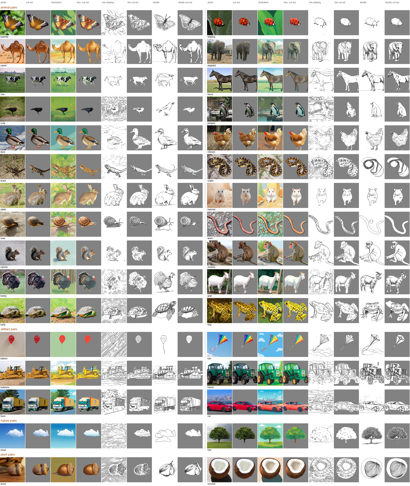

Stylized stimuli: contact sheet and checks
================

Illustrations, line drawings and doodles are generated by
`pipeline/10_stylize.py` from the same 600 px crop as the photo, so each
object keeps its position and size; each style also gets a cut-out
inside the photo’s mask. Generation settings per word are in
`stimuli/stylize_params.csv`.

## Contact sheet

One row per pair as shown on a trial, word A’s formats then word B’s
(`pipeline/13_format_sheet.py`).



## Generation settings

``` python
sp = pd.read_csv(f'{STIM}/stylize_params.csv')
print(sp.groupby('style').size().to_string())
print(sp[sp.label != sp.word].to_string(index=False))
```

    style
    illustration    32
           style     word  seed  cscale                                         label  round                                                                           note
    illustration    cloud     4     0.9        single white cloud in a clear blue sky      2 no rain; best silhouette (IoU .89 vs .72/.56); small sun lies outside the mask
    illustration squirrel     3     0.9                         grey squirrel sitting      2                                      grey squirrel, no white paw blob; IoU .93
    illustration   monkey     3     0.9                                monkey sitting      2  silhouette fixed: IoU .89 area x1.03 (was .60 x1.66); s2/s4 still x2.08/x1.46
    illustration   turkey     4     0.9                   single turkey with one head      2                                            one head (from turkey_11s); IoU .96
    illustration  balloon     1     0.7                             red party balloon      1                                                                            NaN
    illustration   lizard     1     0.7                                  brown lizard      1                                                                            NaN
    illustration    snake     3     0.9               brown and black patterned snake      2                            brown/black like the photo (s4 orange-red); IoU .88
    illustration     frog     1     0.7                           yellow spotted frog      1                                                                            NaN
    illustration     crow     2     0.9                  black crow standing on grass      2                                                     no grey band at the bottom
    illustration    camel     4     0.9                   camel standing on four legs      2                                               legs clearest; all three IoU .93
    illustration    snail     4     0.9 garden snail with a single pair of eye stalks      2                           single pair of eye stalks; best silhouette (IoU .95)
    illustration    acorn     3     0.9            brown acorn with a brown scaly cap      2             brown cap; s2 has a green leaf inside the cut-out, s4 a white band
    illustration      cow     4     0.9                  black and white holstein cow      2                               black and white (s2 grey-blue, s3 pinkish belly)
    illustration   rabbit     2     0.9                             brown wild rabbit      2                     least grass inside the cut-out (3.3% green vs 8.6% before)

Words whose prompt label differs from the bare word: “balloon” alone
drifts to a hot-air balloon, and lizard/frog drift to green.

## Does the stylized object keep the photo’s silhouette?

`pipeline/11_silhouette_check.py`: segment the stylized image with the
same Grounding DINO + SAM recipe as the photo and compare with the
photo’s mask. The cut-out version always uses the photo’s mask, so a low
IoU means the illustration’s object is a different shape and its cut-out
clips it (or shows background inside the mask).

``` python
f = f'{OUT}/silhouette_check.csv'
if os.path.exists(f):
    s = pd.read_csv(f)
    print(s.groupby('style')[['iou', 'area_ratio']].describe().round(2).T.to_string(), '\n')
    print(s.sort_values('iou').head(8).to_string(index=False))
else:
    print('not run yet')
```

    style             illustration
    iou        count         32.00
               mean           0.93
               std            0.05
               min            0.82
               25%            0.90
               50%            0.94
               75%            0.97
               max            0.98
    area_ratio count         32.00
               mean           1.00
               std            0.06
               min            0.84
               25%            0.97
               50%            0.99
               75%            1.01
               max            1.19 

           style      word   iou  area_ratio
    illustration      worm 0.823       0.845
    illustration       car 0.839       1.191
    illustration   hamster 0.844       1.070
    illustration    lizard 0.844       1.049
    illustration    rabbit 0.863       0.955
    illustration bulldozer 0.866       0.960
    illustration    monkey 0.878       1.068
    illustration     snake 0.893       0.901

## Regenerated illustrations (round 2)

Flaws found on review of the first-round illustrations, and the redo
that replaced each. Candidates were generated with ControlNet scale 0.9,
seeds 2–4 and a corrected prompt label (`10_stylize.py --candidates`).
Picks are **provisional**: chosen for the specific flaw and the
silhouette IoU against the photo mask. Replaced versions are in
`stimuli/images/history/round1/`. Every candidate, beside the photo and
the old version: `docs/figures/illustration_redo_candidates.png`.

| Word     | Problem in round 1                                | Prompt label for the redo                         |
|----------|---------------------------------------------------|---------------------------------------------------|
| snail    | two pairs of eye stalks                           | garden snail with a single pair of eye stalks     |
| turkey   | two heads (the turkey_04s photo showed two birds) | single turkey with one head (now from turkey_11s) |
| acorn    | green cap                                         | brown acorn with a brown scaly cap                |
| camel    | hind legs muddled                                 | camel standing on four legs                       |
| squirrel | white blob at the paws                            | grey squirrel sitting                             |
| crow     | grey band across the bottom                       | black crow standing on grass                      |
| cloud    | rain streaks                                      | single white cloud in a clear blue sky            |
| cow      | pink                                              | black and white holstein cow                      |
| snake    | yellow / teal                                     | brown and black patterned snake                   |
| rabbit   | grass inside the cut-out                          | brown wild rabbit                                 |
| hamster  | fatter than the photo (IoU .66, area ×1.37)       | hamster (ControlNet 0.9 only)                     |
| monkey   | fatter than the photo (IoU .60, area ×1.66)       | monkey sitting                                    |

Hamster and monkey were fat because img2img at strength 1.0 with
ControlNet at 0.7 let SDXL drift toward its prior body shape; the photo
mask then trimmed the illustration’s cut-out. The pick and the reason
for each word:

``` python
print(sp[(sp['style'] == 'illustration') & (sp['round'] == 2)][['word', 'seed', 'note']].to_string(index=False))
```

        word  seed                                                                           note
       cloud     4 no rain; best silhouette (IoU .89 vs .72/.56); small sun lies outside the mask
    squirrel     3                                      grey squirrel, no white paw blob; IoU .93
      monkey     3  silhouette fixed: IoU .89 area x1.03 (was .60 x1.66); s2/s4 still x2.08/x1.46
      turkey     4                                            one head (from turkey_11s); IoU .96
       snake     3                            brown/black like the photo (s4 orange-red); IoU .88
        crow     2                                                     no grey band at the bottom
       camel     4                                               legs clearest; all three IoU .93
       snail     4                           single pair of eye stalks; best silhouette (IoU .95)
       acorn     3             brown cap; s2 has a green leaf inside the cut-out, s4 a white band
         cow     4                               black and white (s2 grey-blue, s3 pinkish belly)
      rabbit     2                     least grass inside the cut-out (3.3% green vs 8.6% before)
     hamster     4        silhouette fixed: IoU .85 area x1.03 (was .66 x1.37); s2/s3 still x1.25
