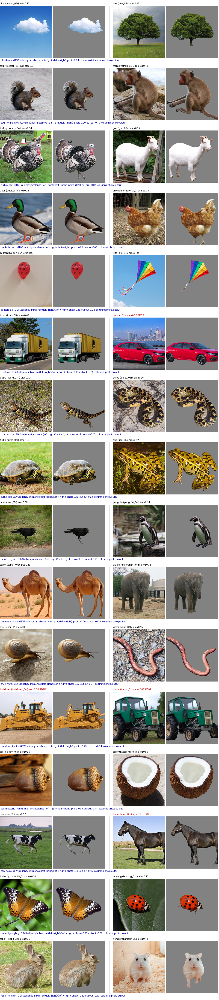
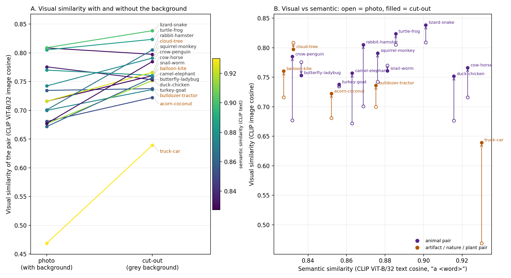
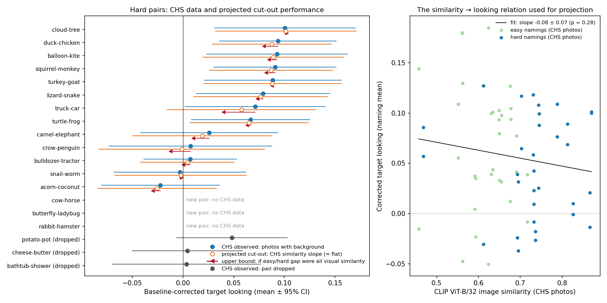

# Visual format study: photos vs cut-outs

Repo copy of the shared doc "Visual format study: photos vs cut-outs" (2026-10-20). Numbers here come from
`pipeline/output/`. Edit the shared doc first and mirror changes here.

Rerun the CHS looking-while-listening study with hard pairs only, showing each pair once as a full photo and once as
the same photo with its background replaced by grey. The question is empirical: cut-outs could help (less
distracting background) or hurt (background context aids recognition), and we can predict which items should go
which way before collecting data.

## Why backgrounds

In CHS, baseline looking followed the backgrounds, not similarity. Spriet et al. (2022) found similarity structure in
baseline looking using cut-outs on grey, which CHS never tested.

- **Baseline looking tracks saliency.** On first views of each pair (2,281 trials, 155 kids), the GBVS saliency
  difference predicted which image kids looked at (ρ = .46, p = .009). This held at every age from 14 to 25 months.
- **The saliency is mostly background.** 58% of GBVS mass fell on backgrounds. Looking tracked background saliency
  (ρ = .49), not object saliency or object size.
- **No graded similarity effect on baseline looking.** THINGS SPoSE, CLIP and other embeddings did not predict
  baseline imbalance (e.g. CLIP ρ = .16, n.s.). Removing backgrounds statistically did not reveal one.
- **Naming does show a similarity effect, but only easy vs hard.** Baseline-corrected looking was higher for easy
  than hard pairs (.065 vs .044, within child, n = 154, p = .046). Continuous CLIP similarity did not predict it.
- **Spriet et al. used cut-outs on grey.** Their 19-month effect (ρ ≈ .25) came from category models (8-category,
  animacy, humanness), with between-category pairs more imbalanced than same-category pairs.

A statistical control is not a redesign. Varying format directly is the clean test of whether backgrounds hide or help.

## Design

Each child sees 16 hard pairs twice: once as photos and once as cut-outs, with the other word named the second
time. That is 32 trials, the same session length as CHS (about 4.5 minutes).

- **Format is within child and within item.** A pair's two presentations fall in opposite halves of the session.
  Half the kids see a given pair as a photo first.
- **Naming is counterbalanced.** Across four lists, each word is named in each format equally often.
- **Cut-outs are pixel-matched to photos.** Same crop, same object position and size; only the background is
  replaced by grey RGB(130,130,130). The page stays CSS gray (128).
- **Baseline window.** Keep CHS's −2000 to 0 ms window for continuity, and add an explicit silent preview (0–2 s
  after image onset). In CHS the analysed baseline overlapped the carrier phrase.
- **Presentation code.** `experiment/chs_jspsych/experiment.js` is a jsPsych 8 port of the CHS Lookit protocol
  (`experiment/lookit_reference/experiment_sample2.js`) for the CHS jsPsych runner. It keeps the same timing,
  carriers, attention-getters and calibration, and adds the format x naming lists.

| Option | Trials | Kids per pair × format × naming (N ≈ 155) |
| --- | --- | --- |
| Each pair once (format between child) | 16 | ~39 |
| **Each pair twice, once per format (recommended)** | **32** | **~77** |

The repeat is balanced across formats, so it cannot create a format difference. Baseline-preference analyses use
first views only, which avoids the novelty confound found in CHS (kids preferred the less-seen image, .541).

## Stimuli

The set is 16 hard pairs: 13 from CHS with new THINGS exemplars, plus 3 new pairs whose words already have CHS
audio. All 32 words have recordings for all four carrier phrases (find / where / see / look at).

- **Dropped from CHS:** cheese–butter and potato–pot (food items cut out poorly) and bathtub–shower (a shower is a
  room and cannot be cut out). Acorn–coconut was restored by request.
- **Added:** cow–horse, butterfly–ladybug, rabbit–hamster.
- **Exemplars** come from the full THINGS set on Polygon (`data/THINGS-dataset/object_images`), chosen for a whole,
  single, uncropped object. Most come from the first five per concept; car came from the full set. None are the CHS
  images, so the photo condition uses new exemplars.
- **Segmentation** used Grounding DINO ("a \<word\>.") for the box and SAM ViT-H for the mask, each checked by eye.

| Pair | Exemplars | CHS corrected looking | Visual sim, photo → cut-out | Semantic sim | Object area (A / B) | GBVS imbalance, photo → cut-out |
| --- | --- | --- | --- | --- | --- | --- |
| cloud–tree | cloud\_03s, tree\_02s | +0.101 | 0.81 → 0.80 | 0.83 | 0.13 / 0.32 | −0.24 → +0.04 |
| duck–chicken | duck\_01b, chicken2\_01b | +0.094 | 0.68 → 0.75 | 0.92 | 0.28 / 0.31 | −0.00 → −0.01 |
| balloon–kite | balloon\_05s, kite\_04s | +0.093 | 0.72 → 0.76 | 0.83 | 0.06 / 0.10 | −0.36 → −0.24 |
| squirrel–monkey | squirrel\_02s, monkey\_04s | +0.091 | 0.74 → 0.79 | 0.88 | 0.21 / 0.40 | −0.20 → −0.10 |
| turkey–goat | turkey\_04s, goat\_02n | +0.089 | 0.73 → 0.74 | 0.86 | 0.34 / 0.35 | +0.10 → +0.07 |
| lizard–snake | lizard\_03n, snake\_01b | +0.079 | 0.81 → 0.84 | 0.90 | 0.12 / 0.36 | −0.22 → −0.40 |
| truck–car | truck\_05s, car\_11s (edge) | +0.071 | 0.47 → 0.64 | 0.93 | 0.40 / 0.32 | +0.00 → +0.02 |
| turtle–frog | turtle\_04s, frog\_02s | +0.067 | 0.81 → 0.82 | 0.89 | 0.28 / 0.42 | −0.12 → −0.23 |
| camel–elephant | camel\_04s, elephant\_04n | +0.026 | 0.67 → 0.76 | 0.86 | 0.33 / 0.31 | +0.16 → +0.26 |
| crow–penguin | crow\_05s, penguin\_04s | +0.007 | 0.68 → 0.79 | 0.83 | 0.05 / 0.14 | −0.13 → −0.28 |
| bulldozer–tractor | bulldozer\_04s (edge), tractor\_01b (edge) | +0.007 | 0.70 → 0.74 | 0.88 | 0.34 / 0.62 | +0.25 → +0.14 |
| snail–worm | snail\_01b, worm\_01b | −0.003 | 0.77 → 0.76 | 0.88 | 0.18 / 0.15 | −0.07 → −0.07 |
| acorn–coconut | acorn\_01b, coconut\_01b | −0.022 | 0.68 → 0.72 | 0.85 | 0.25 / 0.55 | −0.09 → −0.11 |
| cow–horse | cow\_05s, horse\_05s (edge) | new pair | 0.72 → 0.77 | 0.92 | 0.12 / 0.28 | −0.30 → −0.15 |
| butterfly–ladybug | butterfly\_02s, ladybug\_01b | new pair | 0.78 → 0.75 | 0.84 | 0.30 / 0.10 | +0.26 → +0.30 |
| rabbit–hamster | rabbit\_02s, hamster\_05s | new pair | 0.70 → 0.81 | 0.87 | 0.35 / 0.18 | +0.12 → +0.17 |

The table's columns are defined as follows:

- **CHS corrected looking** is the mean of the pair's two naming means (hard trials, CHS exclusions).
- **Similarity** is CLIP ViT-B/32 cosine on the final 600 px stimuli: image–image for visual, "a \<word\>" text–text
  for semantic.
- **Object area** is the share of the 600 px frame.
- **GBVS imbalance** is (left − right)/(left + right) on a side-by-side display.
- **"Edge"** marks an object that touches the frame, so its cut-out ends in a straight line.



## Visual vs semantic similarity

Removing the background makes 13 of 16 pairs look more alike, raising mean visual similarity from .72 to .76.
Truck–car moves most (.47 → .64), because its photos differ mainly in setting.

- **The format manipulation also changes similarity, by a different amount per pair.** If visual similarity drives
  errors, the pairs that gain most (truck–car, crow–penguin, rabbit–hamster, camel–elephant) should get harder as
  cut-outs.
- **As photos, semantically closer pairs looked less alike** (r = −.37). As cut-outs the relation weakens (r = −.23).
- **CLIP text similarity is a weak semantic measure.** It sits in a narrow band (.83–.93). THINGS SPoSE would
  separate pairs better if semantic distance matters for the analysis.



## Item-level predictions

Backgrounds should help only where they tell the two images apart, and cut-outs should help most where the
background grabs attention. Both scores are computed from the stimuli alone, before any data
(`pipeline/output/item_moderators.csv`).

- **Background diagnosticity (per image).** Cover the object with a plain grey box, so no silhouette survives. Ask
  CLIP (average of ViT-B/32 and ViT-L/14) which of the pair's two words fits the background. 0.5 means uninformative.
- **Context discriminability (per pair)** = diagnosticity A + diagnosticity B − 1. Both backgrounds are on screen on
  every trial, so this is the same whichever word is named. Above 0 means the backgrounds point each image to its own
  word; around 0 means they do not separate the pair.
- **Background clutter (per image)** = share of the photo's GBVS saliency mass outside the object. It is only weakly
  related to diagnosticity (r = .17), so it is a separate predictor.
- **CLIP cannot stand in for recognition.** It names every object correctly with or without its background, so the
  photo-vs-cut-out recognition drop is uninformative.

| Pair | Background A → A | Background B → B | Context discriminability | Background saliency share (A / B) | Predicted photo advantage |
| --- | --- | --- | --- | --- | --- |
| duck–chicken | 0.78 | 0.86 | +0.64 | 0.52 / 0.54 | Largest |
| crow–penguin | 0.66 | 0.95 | +0.60 | 0.85 / 0.73 | Large (but most cluttered) |
| balloon–kite | 0.58 | 0.95 | +0.53 | 0.56 / 0.56 | Large |
| camel–elephant | 0.76 | 0.75 | +0.51 | 0.56 / 0.67 | Large |
| rabbit–hamster | 0.84 | 0.65 | +0.48 | 0.51 / 0.56 | Large |
| squirrel–monkey | 0.65 | 0.82 | +0.47 | 0.48 / 0.56 | Large |
| turkey–goat | 0.91 | 0.41 | +0.32 | 0.50 / 0.57 | Moderate |
| acorn–coconut | 0.83 | 0.41 | +0.24 | 0.53 / 0.27 | Moderate |
| bulldozer–tractor | 0.45 | 0.73 | +0.18 | 0.43 / 0.31 | Small |
| butterfly–ladybug | 0.54 | 0.64 | +0.17 | 0.45 / 0.56 | Small |
| turtle–frog | 0.51 | 0.62 | +0.14 | 0.47 / 0.36 | Small |
| cow–horse | 0.91 | 0.22 | +0.13 | 0.69 / 0.63 | Small |
| cloud–tree | 0.99 | 0.11 | +0.10 | 0.56 / 0.53 | Small |
| truck–car | 0.36 | 0.63 | −0.01 | 0.44 / 0.43 | None |
| lizard–snake | 0.56 | 0.34 | −0.10 | 0.76 / 0.43 | None |
| snail–worm | 0.38 | 0.51 | −0.10 | 0.63 / 0.74 | None |

In cow–horse, cloud–tree and truck–car, both backgrounds point to the same word (a field reads "cow", a sky reads
"cloud", a road reads "car"). Context cannot separate those pairs, even though one image's background is strongly
diagnostic.

- **H-context:** the photo advantage (photo minus cut-out corrected looking) increases with context discriminability.
- **H-clutter:** the cut-out advantage increases with the background saliency share of the target photo.
- **Validate before freezing.** CLIP is a proxy. A short adult norming task would anchor diagnosticity in human
  judgement: show the background-only images (`stimuli/images/background_only`) and ask "which word goes here?" That
  is 32 images, about 50 Prolific adults, about 10 minutes.

## Analysis plan to preregister

The primary test is the format effect on baseline-corrected target looking. It is two-sided, because both directions
have a real rationale.

1. **Primary DV:** baseline-corrected target looking (critical window minus baseline window), with CHS windows and
   exclusions.
2. **Primary model** (trial level):

   ```
   corrected ~ format * (discrim_c + clutter_c) + age_c + (format | child) + (format | pair)
   ```

3. **Confirmatory:** the format main effect (two-sided), H-context and H-clutter (directional).
4. **Exploratory:** age × format (older toddlers may use scene context more), and per-pair format effects reported
   with intervals rather than tested.
5. **Secondary, baseline window:** on first views only, does baseline looking follow GBVS saliency less for cut-outs
   than photos? In CHS photos the correlation was ρ = .46. Analyse both the −2000–0 ms window and the silent 0–2 s
   preview.
6. **Covariates recorded per pair:** change in visual similarity (photo → cut-out), GBVS left–right imbalance in each
   format, object-area difference, and the edge flag.

Freeze the item scores (exemplars, masks, diagnosticity, clutter) before data collection. Any exemplar change means
rerunning `pipeline/04`–`09`.

## What CHS can and cannot project

CHS data cannot predict the cut-out result; that is why the study is worth running. Projecting from similarity alone
moves almost no pair.

- **Projection method.** Fit corrected looking on CLIP photo similarity across all 64 CHS namings (slope −0.08 ±
  0.07, p = .28; within hard pairs alone −0.01, p = .93). Then shift each pair by slope × (cut-out similarity − photo
  similarity), both measured on the new stimuli, so the shift reflects the format change alone.
- **Upper bound.** Assume the whole easy/hard gap (.021) came from visual similarity, which implies a slope of −0.18.
- **Result.** Every pair but truck–car shifts by less than .01. Truck–car shifts most (.071 → .058, or .040 at the
  upper bound).
- **The projection assumes backgrounds act only through similarity**, which is exactly the assumption the study tests.



**Power.** With about 155 kids, the format main effect should detect a gap the size of the CHS easy–hard difference
(.02) roughly half the time. Item-level moderators across 16 pairs only register if they are large. Plan N on the main
effect, or raise N if the moderators are the point.

**A Spriet-style baseline similarity effect is unlikely here.** Their effect came from category structure:
between-category pairs were more imbalanced than same-category pairs. Every pair here is a within-domain hard pair,
with no animacy crossings and no humans. Cut-out visual similarity spans only .64–.84. A pair-level test with 16 pairs
has about 15% power for ρ = .25.

If the baseline question matters, re-pair the same 32 images across categories (cow with truck, acorn with penguin)
for some trials. That needs no new images or audio but costs the within-pair format comparison.

## Open decisions

- [ ] Swap horse\_05s (touches the frame) for horse\_01b or horse\_02s, then rerun `pipeline/04`–`09`
- [ ] Keep or drop the four pairs at floor in CHS (camel–elephant, crow–penguin, bulldozer–tractor, snail–worm); they
      show a format effect only if cut-outs help
- [ ] Decide whether to match object size within pairs (one identical zoom-and-crop applied to both formats), e.g.
      crow .05 vs penguin .14, lizard .12 vs snake .36
- [ ] Run the adult background-diagnosticity norming and replace the CLIP scores
- [ ] Decide whether to add cross-category re-pairings for a Spriet-style baseline test
- [ ] Choose N from the format main effect
- [x] Write the new protocol (16 pairs × 2 formats, four counterbalanced lists): `experiment/chs_jspsych/experiment.js`
- [ ] IRB check of the updated intro and debrief wording; upload the photos and cut-outs to the stimulus server
- [ ] Freeze stimuli and item scores, then preregister
